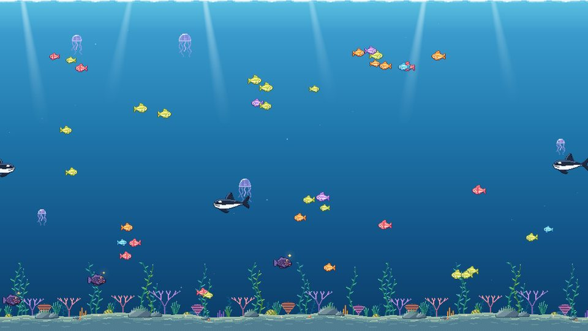
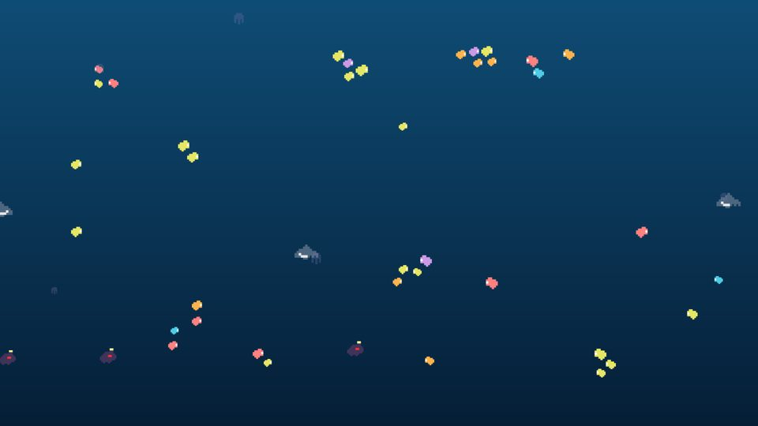
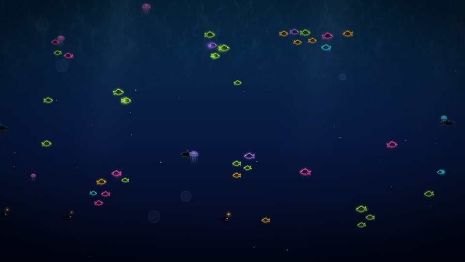
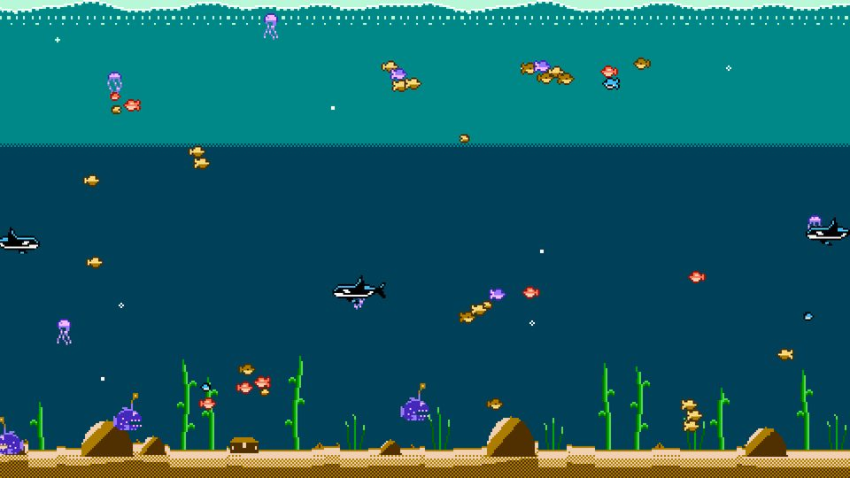
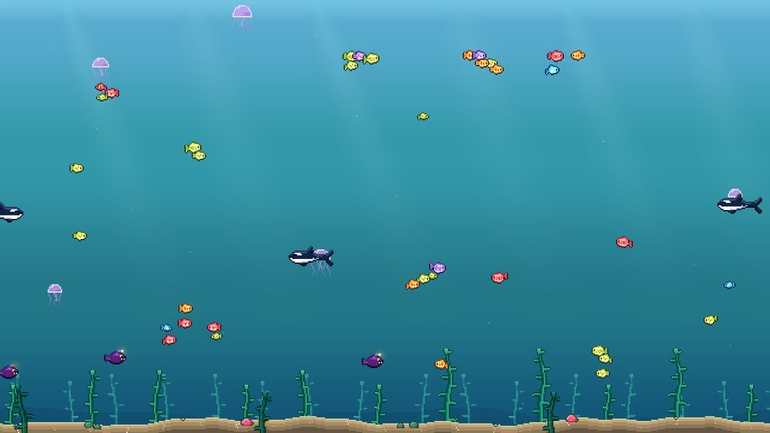
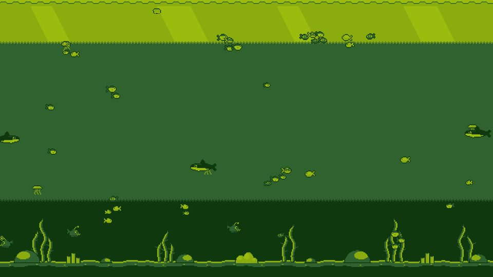
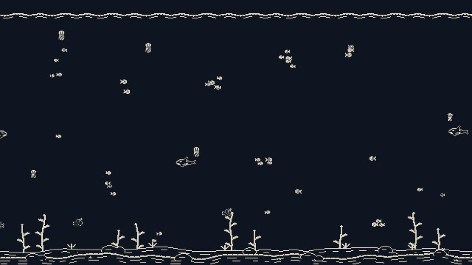
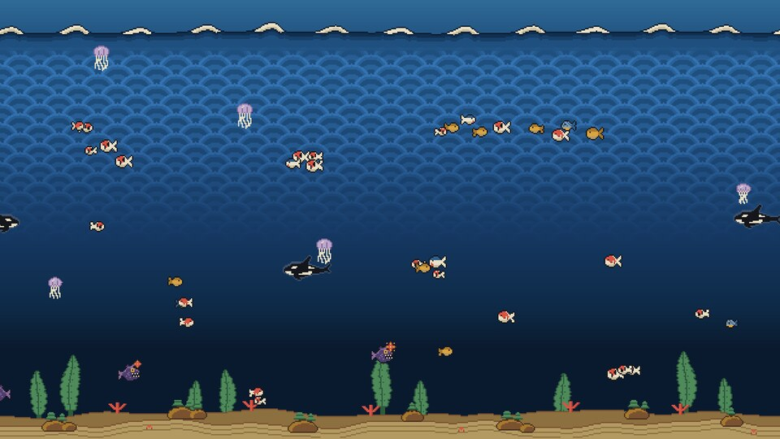

# Boids in the Blue

A live wallpaper for KDE Plasma 6: a school of boids (Craig Reynolds' flocking model, 1987) with fish, jellyfish, anglerfish and orcas. It has eight visual themes, reacts to processor and graphics card load and to the cursor, and pauses when windows cover the desktop.

<div align="center">
  
</div>

## Demo

https://github.com/user-attachments/assets/d896e1b9-4d1e-4f65-bfdf-85580c7df1e8

## Screenshots

<table>
  <tr>
    <td align="center"><br>Refined Pixel</td>
    <td align="center"><br>Classic</td>
  </tr>
  <tr>
    <td align="center"><br>Bioluminescent</td>
    <td align="center"><br>NES</td>
  </tr>
  <tr>
    <td align="center"><br>Amiga</td>
    <td align="center"><br>Game Boy</td>
  </tr>
  <tr>
    <td align="center"><br>1-Bit</td>
    <td align="center"><br>Ukiyo-e</td>
  </tr>
</table>

## Themes

Pick a theme on the **Appearance** tab of the settings. The change applies immediately.

| Theme | Look |
|---|---|
| Refined Pixel (default) | Crisp pixel art with light shafts |
| Classic | The original look |
| Bioluminescent | Glowing creatures in dark water |
| NES | NES-style 8-bit palette |
| Amiga | Copper-gradient sea |
| Game Boy | Four LCD greens |
| 1-Bit | Two colors: ink on paper |
| Ukiyo-e | Japanese woodblock print |

## Features

- **Flocking**: fish school with separation, alignment and cohesion. Four presets (Calm, Default, Lively, Chaotic) and advanced values for each rule.
- **Reacts to load**: the fish turn red, swim faster and shake as the processor, the graphics card or a chosen sensor gets busier. Read from KDE's System Monitor sensors.
- **Reacts to the cursor**: fish swim away from the pointer, and orcas chase it.
- **Feeding and breeding**: a click drops a worm. For every 10 worms the school eats, a baby fish is born, up to 20 extra fish.
- **Predators**: orcas and anglerfish hunt fish. Fish scatter when a predator passes.
- **Day and night**: optional. The water brightens and darkens with the time of day.
- **Pauses when covered**: the animation and sensors stop while maximized or fullscreen windows, or windows covering a set share of the screen, hide the wallpaper, and while the screen is off. Each screen is independent.

### Mouse

- Left-click: drop a worm.
- Left-click and drag: the fish flee from the pointer and bubbles rise.
- Right-click: a burst of bubbles.

## Settings

The settings are split into five tabs:

- **Appearance**: the visual theme.
- **Ocean**: how many fish, jellyfish, anglerfish and orcas there are, their sizes, and the size of the worms.
- **Behavior**: the flocking style, the cursor reaction, predator aggression and speed, and the advanced flocking values.
- **Environment**: day and night, and the water colors.
- **System**: what the wallpaper reacts to and how strongly, and when to pause.

**Reset to defaults** is at the bottom of the page.

## Installation

Requirements: KDE Plasma 6 with `kpackagetool6`.

### From the KDE Store

In the wallpaper settings, choose *Get New...*, then search for "Boids in the Blue".

### From the repository

```bash
git clone https://github.com/arcanorca/boids-in-the-blue.git
cd boids-in-the-blue
./install.sh
```

`install.sh` installs or upgrades the package and clears the QML cache. It asks whether to restart Plasma.

To install by hand, or to remove the package:

```bash
kpackagetool6 --type Plasma/Wallpaper --install .
kpackagetool6 --type Plasma/Wallpaper --upgrade .
kpackagetool6 --type Plasma/Wallpaper --remove com.github.arcanorca.boidsintheblue
```

Plugin id: `com.github.arcanorca.boidsintheblue`.

### Upgrading from 1.1

Version 1.2 has a new plugin id (`org.kde.plasma.boidsaquarium11` before, `com.github.arcanorca.boidsintheblue` now).

- **install.sh**: copies your settings to the new id, switches your desktops to the new plugin and removes the old package. This needs a running Plasma session. If Plasma is not reachable, the old package stays installed and your settings are not changed.
- **KDE Store**: install 1.2, select "Boids in the Blue" in the wallpaper settings, and remove the old 1.1 entry. Settings must be set again.

## Other versions

The GNOME and web versions use the same simulation core (`core/boids-core.js`), so the flocking, worms, bubbles, breeding, predators and cursor fear behave the same. Each port has its own renderer and input code.

- **GNOME Shell** (`boids-gnome-port/`): a GNOME Shell extension. It has no settings window; edit the `CONFIG` object at the top of `extension.js`. There is no pointer interaction. Not tested in a real GNOME session yet.
- **Web** (`boids-web/index.html`): a standalone page for any modern browser. Keep `boids-core.js` next to it. Left-click drops a worm, right-click bursts bubbles, and the cursor scares the fish. Edit the `CONFIG` object in the page to change the counts and sizes.

## Development

```bash
npm test          # checks that the generated core copies are current, then runs the Node tests
npm run build     # regenerates the core copies (contents/ui/code/boids-core.js, boids-gnome-port/boids-core.js, boids-web/boids-core.js)
npm run test:qml  # QML checks with qml6 (offscreen): golden scenes, theme switching, settings page, render smoke
npm run flock     # flocking metrics for each preset (tests/flock-eval.js)
```

- `core/boids-core.js` is the only copy of the simulation. Edit it, then run `npm run build`. Do not edit the generated files.
- `tests/fixtures/golden.json` and `tests/fixtures/golden.qml.txt` record the simulation output. A refactor must not change them. Regenerate them with `npm run golden:gen` only for a deliberate behavior change.
- `tools/` generates the theme art: `gen-pixel-theme.js`, `gen-biolum.py`, `gen-nes-theme.js`, `gen-amiga-theme.js`, `gen-gameboy-theme.js`, `gen-onebit-theme.js` and `gen-ukiyoe-theme.js`. `gen-previews.js` renders the settings cards' `preview.png` files, and `gen-golden.js` regenerates the golden fixtures. The Classic theme has no generator; it uses the original delegate.

### Adding a theme

1. Create `contents/themes/<id>/` with a `Scene.qml` that follows the contract at the top of `contents/ui/code/themes.js`.
2. Add one entry to `THEMES` in `contents/ui/code/themes.js` (id, name, description, `usesDayNight`, `usesWaterColors`).
3. Add a 480x270 `preview.png` for the settings card (`node tools/gen-previews.js`), and add the id to the theme lists in `tests/themes.test.js`, `tests/qml-switch.js` and `tests/qml/switch.qml`.

## Changelog

### 1.2

- Seven new themes. Refined Pixel is the default.
- Settings rebuilt: five tabs, theme previews, flocking presets, help buttons.
- Fish no longer pass through each other, and move more smoothly.
- Pauses when windows cover the desktop or the screen is off.
- The simulation runs at the same speed on any display refresh rate.
- Refined Pixel: smooth water gradient instead of stepped bands.
- New plugin ID `com.github.arcanorca.boidsintheblue`; `install.sh` migrates your settings.
- Bug fixes: worm eating, baby fish, resizing, the sensor setting, corrupted upgrades.

Older versions are in the git tags `v1.0` and `v1.1`.

## Credits and license

Created by Arcanorca. Licensed under the GNU General Public License v3.0 or later (GPL-3.0-or-later).
